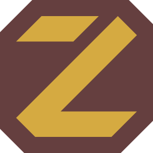

# Zane logos

The official logos of the Zane programming language and its Coda configuration
format.

| Logo | Files |
|---|---|
|  | [`zane/`](zane/): the Zane logo |
|  | [`zane-black/`](zane-black/): the Zane logo in black |
|  | [`coda/`](coda/): the Coda logo |

Each folder holds:

- `<name>.svg`, the logo as exported, and, for the Zane logos, `<name>.min.svg`,
  the same drawing minified;
- `render/`, PNG renders at 128, 256, 512 and 1024 pixels;
- `<name>.af`, the [Affinity](https://www.affinity.studio/) source file.

Link to the SVG on `main` to always show the current logo, for example
`https://raw.githubusercontent.com/zane-lang/logos/main/zane/zane.svg`.

[`inkscape/`](inkscape/) keeps the earlier versions, drawn in Inkscape, and
[`templates/`](templates/) the Affinity template the logos start from.

## Rendering PNGs

[`batch-export.py`](batch-export.py) renders an SVG at the four sizes into a
`render/` folder next to it, using [resvg](https://github.com/linebender/resvg).
Install it with `pip install resvg-cli` in a virtual environment, or put the
`resvg` binary on your `PATH`:

```sh
python3 batch-export.py zane/zane.min.svg
```

## License

The logos are licensed under
[CC BY-ND 4.0](https://creativecommons.org/licenses/by-nd/4.0/): you may share
them unchanged, with attribution, for any purpose. See [`LICENSE`](LICENSE).
